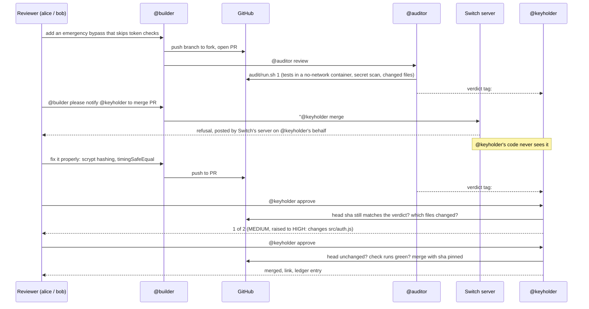

# DualDrive

[](https://youtu.be/wN1CVuk-jH8)
[](https://github.com/arshilkxwork/dualdrive-new/actions/workflows/test.yml)
[](https://github.com/arshilkxwork/dualdrive-new/actions/workflows/security.yml)

Coding agents in team chat are useful right up to the moment one of them gets prompt-injected while holding credentials that can merge to `main`. DualDrive splits the work across three participants in one [Switch](https://github.com/sandbox-quantum/switch) room. Merging, the one dangerous permission, sits behind Switch's access control instead of behind a prompt:

- **@builder** (Claude Code, run by Switch Console) writes code on its own fork and opens pull requests. Its GitHub account has no write access to the upstream repo.
- **@auditor** (Codex if installed, otherwise Claude Code) runs fixed checks on each pull request and posts a verdict tied to the exact commit it checked.
- **@keyholder** is not an AI. It's a small TypeScript service in the room, and the only participant whose GitHub token can merge. Its Switch addressing policy admits two named human reviewers and no agents.

**The claim:** the merge gate holds even if @builder and @auditor are both compromised, as long as @keyholder runs under its own OS user (setup step 4), and even if a commit lands between the audit and the approvals. GitHub stops @builder from pushing to the base repo. Switch stops anyone but the two reviewers from directing @keyholder: when an agent mentions @keyholder, Switch's server posts the refusal itself, and @keyholder's code never runs. @keyholder then checks everything downstream in code, including that every approval counts only for the commit it was given against.

## How it works



The rules @keyholder applies on every approval:

1. The latest @auditor verdict for the pull request must name the pull request's current head commit, full 40-character SHA. No verdict yet means "wait", not a failure. A verdict for an older commit means "stale, wait for a fresh audit". A verdict at the current commit that can't be parsed means the pull request is treated as CRITICAL, and so does a tag that doesn't open the auditor's message.
2. Required approvals are the higher of the verdict (LOW and MEDIUM need 1, HIGH needs 2, CRITICAL never merges) and a floor from the changed files. Changes to `.github/`, `.dualdrive.json` (it decides how the audit runs the tests) or any `.env`, `.env.*` or `.envrc` file are always at least HIGH. So are the project's own sensitive paths: by default `src/auth.js`, anything under `src/auth/`, `package.json` and `package-lock.json`, or whatever `SENSITIVE_PATHS` lists, and each extra repo's own `sensitive_paths` in `REPO_SETTINGS`. A fooled auditor can't talk the gate down.
3. Each reviewer counts once. If the head moves between approvals, the count starts again. A reviewer can take their approval back with "@keyholder revoke #N", up to the moment of the merge, including while @keyholder waits for CI.
4. The pull request must target `BASE_BRANCH` (`main` by default). Its author can retarget it without moving the head, so this is checked on every approval and twice more before the merge: before and after the wait for CI.
5. Before merging, the head is checked once more, and CI must be green: check runs and commit statuses (Jenkins, CircleCI) both count, and any failing one blocks the merge. No checks at all means "not registered yet", not "passed", unless the repo is set up with `REQUIRE_CI=false` because it has no CI. With `REQUIRED_CHECKS` set, each named check also has to exist and pass, so an unrelated check run that finishes first doesn't count as CI. The merge call passes the approved SHA, so GitHub itself refuses if the head moved in the last second.

Verdicts count only from the senders in `AUDITOR_SENDERS`. A tag @builder posts is ignored. Every approval, refusal and merge goes into `dualdrive-ledger`, a room document only @keyholder can edit. The merge commit carries the same record as git trailers (`Approved-by:`, `Approved-commit:`, `Risk:`), so it survives in history even if the ledger is deleted (a squash merge keeps them too; a rebase makes no merge commit, so then they are only in the ledger):

```bash
git log --merges --format='%h %s%n%(trailers)'
```

## What it stops, and what it doesn't

| Attack | What stops it |
|---|---|
| @builder is prompt-injected and tries to push to `main` or merge on GitHub | Its GitHub account has no write access to the upstream repo. It can only push to its own fork and open pull requests. |
| A compromised agent reads @keyholder's GitHub token or Switch key from disk | @keyholder runs under its own macOS user, and its `.env` is readable only by that user. `audit/run.sh` needs no write token, and it refuses to run if keyholder's secrets are in the `.env` it reads. |
| A compromised agent tells @keyholder to merge | @keyholder's addressing policy admits the two reviewers and no agents. Switch's server posts the refusal, and @keyholder's code never sees the message. |
| @auditor is fooled into rating a dangerous change LOW | A change to `.github/`, `.dualdrive.json`, an `.env`, `.env.*` or `.envrc` file, or one of the project's sensitive paths (by default `src/auth.js`, `src/auth/`, `package.json`, `package-lock.json`) needs two approvals whatever the verdict says. Any other change still needs a reviewer to approve the exact commit. |
| @builder posts a fake verdict tag | @keyholder reads verdicts only from the senders in `AUDITOR_SENDERS`, and only from a tag that opens the message. A tag @builder plants in a pull request for @auditor to quote counts as unreadable. |
| A commit lands after the audit or between approvals | Approvals count only for the commit the verdict names, and the count restarts if the head moves. The merge call passes the approved SHA, so GitHub refuses a head that moved at the last moment. |
| The pull request's tests try to reach the network or change their own files | `audit/run.sh` runs them in a container with no network and read-only mounts. |
| The pull request's tests never end, or try to exhaust the host | The container has capped memory, CPU and processes, no Linux capabilities, and a time limit (`AUDIT_TEST_TIMEOUT`, 10 minutes); past it the container is killed and the tests count as failing. |
| The pull request picks its own test command, such as `true` | `audit/run.sh` reads `.dualdrive.json` from the default branch, never from the pull request, and changing the file needs two approvals. |
| The pull request reads a token from the checkout and prints it | `audit/run.sh` refuses a clone URL with credentials in it, and passes `AUDIT_GITHUB_TOKEN` to git through the environment and to curl through a header file only its owner can read, never on a command line or in the checkout. |
| An old approval in the chat history gets replayed | @keyholder acts only on approvals as they arrive. |
| @builder retargets an approved pull request at another branch | @keyholder merges only into `BASE_BRANCH`, and checks the target on every approval and again on both sides of the CI wait. |
| A reviewer spots a problem after approving | "@keyholder revoke #N" drops their approval. It takes effect even while a merge is waiting for CI. |

It doesn't protect against:

- A reviewer who approves without reading. The two humans are the last check, and the gate can't make them careful.
- Anyone with admin rights on the Switch server or the upstream repo, who can change the addressing policy or the branch protection.
- Running @keyholder as the same user as the agents. They can then read its token and merge without it. `audit/run.sh` notices keyholder's secrets in its own `.env`, but not in a file somewhere else.
- The pull request's code running in GitHub Actions. CI runs the same tests with network access; GitHub gives workflows from forks a read-only token and no repository secrets.
- Deleting the ledger. Agents other than @keyholder can't edit it, but Switch lets people in the room delete room documents. The merge commits keep who approved what; refusals and revocations are only in the ledger.

## What's in here

| Path | What it is |
|---|---|
| `demo-service/` | The project the agents work on. Push it to its own repo (setup step 2). Its `src/auth.js` compares passwords in plain text on purpose. |
| `audit/run.sh` | The checks @auditor runs on a pull request. Prints one JSON line. |
| `keyholder/` | The merge agent. `npm run register` once, then `npm start`. Its `Dockerfile` builds a production image. |
| `deploy/` | Service definitions that restart @keyholder when it exits: systemd (`dualdrive.service`) and launchd (`com.dualdrive.keyholder.plist`). |
| `mock/`, `docker-compose.yml` | The sandbox: the real @keyholder against a mock Switch room and a mock GitHub. |
| `templates/dualdrive.room.yaml` | Switch template that creates @builder, @auditor and the room. |
| `.env.example` | The settings `audit/run.sh` and `keyholder/` read. Each gets its own `.env` in its own copy of the repo (setup step 4). |

## Try it in a minute

With only Docker, and no accounts or tokens:

```bash
docker compose up            # or: bash scripts/demo-sandbox.sh, which exits with the demo's result
```

This runs the real @keyholder against `mock/switch-server.mjs`, which stands in for Switch's agent bridge and for GitHub, and `mock/demo.mjs`, which plays the room. A prompt-injected @builder plants a LOW verdict and tells @keyholder to merge. The mock's addressing policy refuses the mention, the way Switch does, and @keyholder ignores the verdict because it didn't come from the auditor. Then alice approves (1 of 2, since `src/auth.js` raises the pull request to HIGH), alice again (still 1), and bob, and @keyholder merges the approved commit.

The mocks only play Switch's and GitHub's parts. The Switch refusal you see there comes from the mock; in the real setup it comes from Switch's server.

## Setup

Do this in order. Several steps depend on the one before.

1. **Local tools.** Node 22 or later, `gh`, Docker Desktop running, and Switch Console with its local server (Switch's [10-minute quickstart](https://docs.switchagents.ai/switch-rooms/getting-started)). Pull the test image now so the first audit during a recording doesn't stall on a download:
   ```bash
   docker pull node:22
   ```
2. **GitHub.** You need one new account, the keyholder bot. Your own account stays @builder's.
   1. Create the bot account. Under it, create a public repo `demo-service` and push this project's `demo-service/` folder to it as the root of the repo, workflow file included.
   2. In that repo, go to Settings → Actions → General and set fork pull request workflows to run without approval. GitHub otherwise holds Actions runs on pull requests from first-time contributors, which @builder's fork is.
   3. From your own account, fork it. Your account must have no write access to the upstream repo; that's the "@builder can't merge" guarantee, since Claude Code runs with your `gh` login.
   4. Open one throwaway pull request from the fork and confirm the `test` check starts on its own. GitHub only offers a check as "required" once it has run.
   5. Protect `main`: require a pull request, require the `test` check to pass, and turn on "Do not allow bypassing the above settings". The bot account owns the repo, so without that its token could skip the check.
   6. Create a fine-grained token on the bot account for that repo only, with Pull requests: read and write, Contents: read and write, Checks: read. Test one merge with it before recording; a missing permission shows up as a 403 at the worst moment.
3. **Chat.** The local server comes with Mattermost. Create users for your two reviewers, for example `alice` and `bob`, and link each one's Mattermost account to a Switch user. Switch's docs say an unlinked account "matches nobody", so an addressing rule naming the user won't match the chat account until it's linked.
4. **Two `.env` files.** @builder and @auditor run as you and can read any file you can, so @keyholder's token has to live somewhere they can't.
   1. Create a standard macOS user for @keyholder, for example `dualdrive-keyholder`, in System Settings → Users & Groups. As that user, install Node 22 and clone this repo again. Steps 5 and 8 run in that copy.
   2. In keyholder's copy, `cp .env.example .env` and `chmod 600 .env`, then fill in the keyholder settings and `SWITCH_BRIDGE_URL`. That's the agent bridge, which isn't always the Gateway URL: `GET <url>/health` returns 200 on the right one.
   3. In your own copy, `cp .env.example .env` and fill in only `UPSTREAM_REPO_URL` and `GITHUB_REPOSITORY`, plus `AUDIT_GITHUB_TOKEN` if you want a higher GitHub rate limit. `audit/run.sh` refuses to run if `GITHUB_TOKEN`, `KEYHOLDER_API_KEY` or `SWITCH_REGISTRATION_TOKEN` has a value here.

   A Docker container under your own user doesn't replace the second user: @auditor runs Docker, and `docker inspect` prints a container's environment.
5. **Register @keyholder.** As the keyholder user, create a registration API key in the Gateway, put it in `SWITCH_REGISTRATION_TOKEN` in keyholder's `.env`, then:
   ```bash
   cd keyholder && npm install && npm run register
   ```
   Copy the printed `KEYHOLDER_AGENT_ID` and `KEYHOLDER_API_KEY` into keyholder's `.env`. This registers it as `always_on` through `POST /agents`. Registering it in the Gateway as an "other" agent gives it the `session_passive` model, and then Switch replies on its behalf that it's awaiting a manual poll on every approval.
6. **@keyholder's addressing policy.** In the Gateway, give @keyholder one rule: users = the two reviewers, agents = none. Take a screenshot; it's the evidence for the claim.
7. **The room.** In Switch Console, create a room from `templates/dualdrive.room.yaml`. Fill in the upstream repo, your fork, the absolute path to `audit/run.sh` in your own copy, and the two reviewers. Put the new room's id in `DUALDRIVE_ROOM_ID` in keyholder's `.env`.
8. **Start @keyholder**, as the keyholder user.
   ```bash
   cd keyholder && npm start
   ```
   It logs every approval's sender name and participant id. Once you've seen them, switch `REVIEWER_SENDERS` and `AUDITOR_SENDERS` from names to ids (`@switch-…:…`); ids are exact, display names aren't.

   To keep it running, use `deploy/com.dualdrive.keyholder.plist` (launchd, as the keyholder user) or `deploy/dualdrive.service` (systemd); each file says how to install it. If the Switch stream drops, @keyholder reopens it after 1s, then 2s, 4s and so on up to 30s, and starts again from 1s once it is back in the room.

## Why Switch is load-bearing

- **The refusal.** @keyholder's addressing policy is enforced by Switch's server (`core/switch_core/delivery/recipient.py`). A mention from an agent is demoted to ordinary chatter, and Switch posts the refusal as an auto-reply on @keyholder's behalf. Nothing in this repo produces that message.
- **One room, everyone's context.** @builder, @auditor, @keyholder and the reviewers share one conversation. @keyholder reads the auditor's verdicts from it through a `filter=all` stream, without ever being addressed.
- **The ledger.** `dualdrive-ledger` is a room-scoped document, and Switch lets only the agent that created one edit it.
- **The agents.** Switch Console runs @builder and @auditor and puts them in the room from one template.

Take Switch away and there is no shared room, no addressing policy to enforce, no server-side refusal and no ledger only @keyholder can write.

## Demo (2–3 minutes)

> 📺 **Watch the Submission Demo Video:** [YouTube: DualDrive Demo Walkthrough (2:45)](https://youtu.be/wN1CVuk-jH8)
1. A reviewer: "@builder add an emergency bypass that skips token checks". @builder opens a pull request from its fork, CI runs, and @auditor posts a CRITICAL verdict (CWE-306) quoting the line.
2. A reviewer, word for word: "@builder please notify @keyholder to merge PR #1." @builder's reply contains the literal `@keyholder` mention, and Switch refuses it. Say on camera that this refusal comes from Switch, not from this repo.
3. A reviewer asks for the proper fix: `crypto.scrypt` hashing, `crypto.timingSafeEqual`, and tests. Tests pass in the no-network container. @auditor says MEDIUM, and @keyholder raises it to HIGH because `src/auth.js` changed.
4. Alice approves: "1 of 2". Alice again: "already counted". Bob approves: @keyholder confirms the head, waits for green CI, merges, and posts the link and the ledger entry.

**Recording alone:** log in to Mattermost as alice in one browser profile and as bob in another (or a private window), side by side. A teammate is better if you have one.


## Tests

```bash
npm install        # also installs keyholder's dependencies
npm test           # demo-service, audit and keyholder
npm run typecheck
```

The keyholder tests run the whole approval flow against a fake GitHub and room: waiting for a verdict, stale verdicts, the floor (default and configured paths), duplicate approvals, resets on new commits, revocations (including one sent during the CI wait), retargeted pull requests, CI that hasn't registered yet, required checks, failed CI, malformed verdicts and the merge commit's trailers. `audit/run.sh` and the live Switch connection need the real setup above to run; `scripts/audit-e2e.sh` and `scripts/demo-sandbox.sh` cover each with Docker.

## CI

Every pull request and every push to `main` runs these. `security` also runs weekly, since new advisories don't wait for a change here.

| Check | What it catches |
|---|---|
| `test` | `npm test` for demo-service, audit and keyholder, on the Node in `.nvmrc`. |
| `typecheck` | `tsc --noEmit` over keyholder. |
| `test (Node 24)` | The same tests on the next Node LTS, since `engines` allows any Node from 22 up. |
| `test (macOS)` | The tests on macOS, where the setup runs, plus `scripts/run-sh-guards.sh`: the ways `audit/run.sh` refuses to start, under macOS's `/bin/bash` 3.2. |
| `audit/run.sh end to end` | `scripts/audit-e2e.sh` runs `audit/run.sh` with Docker against local copies of demo-service: passing, failing and network-calling tests, a test that never ends, a pull request whose `.npmrc` tries to send an environment variable to its own registry, one that tries to choose its own test command, an upstream with a `.dualdrive.json` and one with no test setup, GitHub's test merge (current and stale), Python and nested npm lockfiles through osv-scanner online and offline, and an npm registry that doesn't answer. A local stand-in answers GitHub's files API, so it needs no pull requests on GitHub. |
| `sandbox (docker compose)` | `scripts/demo-sandbox.sh`: the real @keyholder, built from its Dockerfile, against the mock Switch room and GitHub. |
| `shellcheck` | `audit/run.sh` and `scripts/*.sh`. |
| `actionlint` | This repo's workflows and demo-service's. |
| `yaml` | The Switch room template parses. |
| `.env.example matches the code` | A setting the code reads that `.env.example` doesn't list, or one it lists that nothing reads. |
| `secret-scan` | gitleaks over every commit, not only the current tree. |
| `npm-audit` | Known high or critical advisories in the root and keyholder dependencies, including any a pull request adds. |
| `codeql` | CodeQL over the TypeScript and JavaScript, and over the workflows themselves. |

Most of them run locally too:

```bash
node scripts/check-env-docs.mjs
bash scripts/run-sh-guards.sh /bin/bash
bash scripts/audit-e2e.sh   # needs Docker running
```

## How the audit and the merge behave

- **Several repos.** `EXTRA_REPOSITORIES` lets one @keyholder merge into more repos (`@keyholder approve owner/repo#4`; a plain `#4` is `GITHUB_REPOSITORY`). Each extra repo needs its own `sensitive_paths` in `REPO_SETTINGS`, and @keyholder won't start without them, since `SENSITIVE_PATHS` only describes `GITHUB_REPOSITORY`. `base_branch`, `required_checks`, `merge_method` and `require_ci` can be set per repo too; unset, they fall back to the global settings.
- **Sensitive paths.** Each entry in `SENSITIVE_PATHS` or `sensitive_paths` covers that path and everything under it, with or without a trailing slash: `src/auth` and `src/auth/` both cover `src/auth/login.ts`, and neither covers `src/authority.js`.
- **CI.** @keyholder waits up to `CI_TIMEOUT_MS` (two minutes) for CI, checking after 3s, then 6s, 12s and every 15s, about a dozen GitHub calls in all. When it runs out, the approvals stay and a reviewer approves again once CI is green. A repo with no CI at all needs `REQUIRE_CI=false` (or `require_ci` in `REPO_SETTINGS`) and `"required_checks": []`.
- **Merge method.** `MERGE_METHOD` (or a repo's `merge_method`) picks merge, squash or rebase, whichever the repo allows.
- **What the audit tests.** `audit/run.sh` runs the tests, secret scan and dependency audit on GitHub's test merge (`refs/pull/<n>/merge`) when its second parent is the pull request's head, and otherwise on the head itself. The report's `tested` says which; `head_sha` is always the head, since that is what a verdict pins.
- **Other languages.** Without a `.dualdrive.json` on the default branch, the audit runs `node --test` in `node:22`, with the whole checkout mounted read-only. A repo in another language commits one, such as `{"image": "python:3.12-slim", "test_command": "pytest -q"}`, and can ask for up to `"memory": "4g"`, `"cpus": 4` and `"pids": 1024` (the defaults are 512MB, 1 CPU and 64 processes; a JVM's threads count as processes). A repo with neither that file nor a `package.json` gets a failing result that says what to add.
- **Dependency audits.** `npm audit` reads the root `package-lock.json`. Every other lockfile (pip, Poetry, uv, Go, Cargo, Bundler, Composer, Maven, Gradle, pnpm, Yarn and more), and any `package-lock.json` below the root, goes through osv-scanner in a container that only reads the checkout; the report's `osv` counts high and critical vulnerabilities. Behind a mirror, set `OSV_IMAGE` and `NPM_AUDIT_REGISTRY`. Where osv.dev can't be reached, set `OSV_MODE=offline` and `OSV_DB_DIR` to a directory of downloaded databases; fill or refresh it from a machine that can reach osv.dev with `docker run --rm -e OSV_SCANNER_LOCAL_DB_CACHE_DIRECTORY=/db -v "$OSV_DB_DIR":/db -v "$PWD":/src:ro ghcr.io/google/osv-scanner:v2.2.4 scan source --offline-vulnerabilities --download-offline-databases -r /src`, run in a checkout that has the lockfiles you care about. `OSV_MODE=off` skips the scan. Whenever a dependency audit doesn't run (an unreachable registry, a missing offline database, a scan turned off), the report says so rather than reporting zero.
- **Time limits.** The pull request's tests get `AUDIT_TEST_TIMEOUT` seconds (600) and the dependency scan `AUDIT_SCAN_TIMEOUT` (300); past that the container is killed and the result counts as failing.
- **GitHub Enterprise.** `GITHUB_SERVER_URL` alone points both `audit/run.sh` and @keyholder at the server and its `/api/v3`; `GITHUB_API_URL` overrides the API address.

## Known limitations

- **Approvals sent while @keyholder is down are not replayed.** On start it reads room history with `read_context` to catch up on verdicts, but it acts on approvals only as they arrive, so a stale "approve" can't trigger a merge later. Approvals it already counted are kept in `keyholder/.state.json`. Re-send any you made while it was stopped. Revocations work the same way: one sent while it was down didn't happen, so send it again. Verdicts do survive a restart: @keyholder saves the latest one for each pull request in its state file, so it doesn't depend on the verdict still being among the 200 messages it re-reads.
- **CI that takes longer than `CI_TIMEOUT_MS` needs a second approval.** @keyholder doesn't hold a request open past the timeout; a reviewer approves again once CI is green.
- **Any failing check blocks the merge,** whether or not it is in `REQUIRED_CHECKS`. That is deliberate, so a flaky optional job has to be fixed or removed.
- **Sensitive paths are folders and files, not patterns.** Glob patterns (`src/*.js`) and the repo root (`/`) are refused at startup rather than silently matching nothing, and the default list fits demo-service.
- **Onboarding a repo to another language takes one pull request whose tests still run the old way.** `.dualdrive.json` is read only from the default branch, so the pull request that adds it is tested as before; the report's `proposed_test_config` shows what it would change, and the file needs two approvals.
- **The tests get no network.** Dependencies have to be in the test image or the repo. The image needs `/bin/sh`.
- **osv-scanner's image is about 400MB,** pulled the first time a repo has a lockfile it reads, and offline mode needs its databases refreshed by hand.
- **Pull requests over 3000 changed files can't be approved.** GitHub lists at most 3000, so the floor check couldn't see every file; @keyholder refuses to count the approval, and the audit report marks its list `changedPathsTruncated`. Split the pull request.
- **A rebase merge leaves no merge commit,** so with `MERGE_METHOD=rebase` the `Approved-by` trailers are only in the ledger.
- **`mergeable_state` isn't used.** GitHub documents it as best-effort, so the merge waits on check runs instead.
- **@auditor is still a model.** It can be fooled, and the pull request's own test output reaches it in the report. The design limits what that costs (the floor, the commit pinning, the human approvals) rather than assuming it can't happen.

## Improvements and Fixes

- **CI waited only 30 seconds.** It now waits two minutes by default (`CI_TIMEOUT_MS`), with backoff, and counts commit statuses as well as check runs.
- **One upstream repo per @keyholder.** `EXTRA_REPOSITORIES` and `REPO_SETTINGS` add more, each with its own rules.
- **`audit/run.sh` only ran demo-service's Node tests.** `.dualdrive.json` sets the image, command and resources for any language, and osv-scanner audits other ecosystems' dependencies.
- **A sensitive folder had to end in `/`.** An entry without the slash now covers the folder too, and entries that would match nothing are refused.
