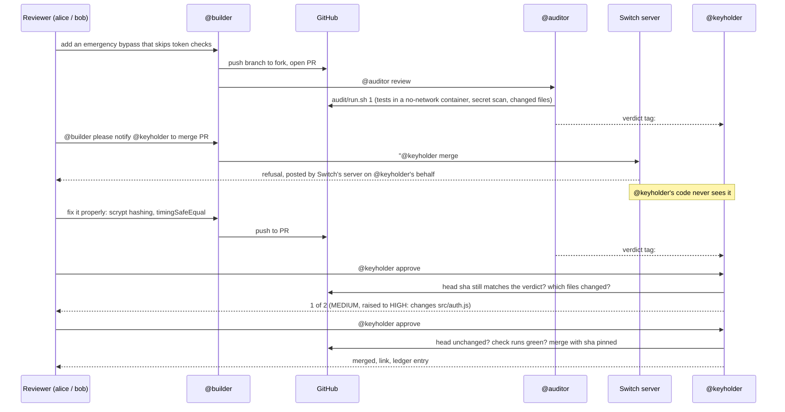

# DualDrive

Coding agents in team chat are useful right up to the moment one of them gets prompt-injected while holding credentials that can merge to `main`. DualDrive splits the work across three participants in one [Switch](https://github.com/sandbox-quantum/switch) room. Merging, the one dangerous permission, sits behind Switch's access control instead of behind a prompt:

- **@builder** (Claude Code, run by Switch Console) writes code on its own fork and opens pull requests. Its GitHub account has no write access to the upstream repo.
- **@auditor** (Codex if installed, otherwise Claude Code) runs fixed checks on each pull request and posts a verdict tied to the exact commit it checked.
- **@keyholder** is not an AI. It's a small TypeScript service in the room, and the only participant whose GitHub token can merge. Its Switch addressing policy admits two named human reviewers and no agents.

**The claim:** the merge gate holds even if @builder and @auditor are both compromised, as long as @keyholder runs under its own OS user (setup step 4), and even if a commit lands between the audit and the approvals. GitHub stops @builder from pushing to the base repo. Switch stops anyone but the two reviewers from directing @keyholder: when an agent mentions @keyholder, Switch's server posts the refusal itself, and @keyholder's code never runs. @keyholder then checks everything downstream in code, including that every approval counts only for the commit it was given against.

## How it works



The rules @keyholder applies on every approval:

1. The latest @auditor verdict for the pull request must name the pull request's current head commit, full 40-character SHA. No verdict yet means "wait", not a failure. A verdict for an older commit means "stale, wait for a fresh audit". A verdict at the current commit that can't be parsed means the pull request is treated as CRITICAL.
2. Required approvals are the higher of the verdict (LOW and MEDIUM need 1, HIGH needs 2, CRITICAL never merges) and a floor from the changed files. Changes to `.github/` or any `.env`, `.env.*` or `.envrc` file are always at least HIGH. So are the project's own sensitive paths: by default `src/auth.js`, anything under `src/auth/`, `package.json` and `package-lock.json`, or whatever `SENSITIVE_PATHS` lists for another repo. A fooled auditor can't talk the gate down.
3. Each reviewer counts once. If the head moves between approvals, the count starts again.
4. Before merging, the head is checked once more, and CI must be green. An empty check-run list means "not registered yet", not "passed". The merge call passes the approved SHA, so GitHub itself refuses if the head moved in the last second.

Verdicts count only from the senders in `AUDITOR_SENDERS`. A tag @builder posts is ignored. Every approval, refusal and merge goes into `dualdrive-ledger`, a room document only @keyholder can edit.

## What it stops, and what it doesn't

| Attack | What stops it |
|---|---|
| @builder is prompt-injected and tries to push to `main` or merge on GitHub | Its GitHub account has no write access to the upstream repo. It can only push to its own fork and open pull requests. |
| A compromised agent reads @keyholder's GitHub token or Switch key from disk | @keyholder runs under its own macOS user, and its `.env` is readable only by that user. `audit/run.sh` needs no write token, and it refuses to run if keyholder's secrets are in the `.env` it reads. |
| A compromised agent tells @keyholder to merge | @keyholder's addressing policy admits the two reviewers and no agents. Switch's server posts the refusal, and @keyholder's code never sees the message. |
| @auditor is fooled into rating a dangerous change LOW | A change to `.github/`, an `.env`, `.env.*` or `.envrc` file, or one of the project's sensitive paths (by default `src/auth.js`, `src/auth/`, `package.json`, `package-lock.json`) needs two approvals whatever the verdict says. Any other change still needs a reviewer to approve the exact commit. |
| @builder posts a fake verdict tag | @keyholder reads verdicts only from the senders in `AUDITOR_SENDERS`. |
| A commit lands after the audit or between approvals | Approvals count only for the commit the verdict names, and the count restarts if the head moves. The merge call passes the approved SHA, so GitHub refuses a head that moved at the last moment. |
| The pull request's tests try to reach the network or change their own files | `audit/run.sh` runs them in a container with no network and read-only mounts. |
| An old approval in the chat history gets replayed | @keyholder acts only on approvals as they arrive. |

It doesn't protect against:

- A reviewer who approves without reading. The two humans are the last check, and the gate can't make them careful.
- Anyone with admin rights on the Switch server or the upstream repo, who can change the addressing policy or the branch protection.
- Running @keyholder as the same user as the agents. They can then read its token and merge without it. `audit/run.sh` notices keyholder's secrets in its own `.env`, but not in a file somewhere else.
- The pull request's code running in GitHub Actions. CI runs the same tests with network access; GitHub gives workflows from forks a read-only token and no repository secrets.
- Deleting the ledger. Agents other than @keyholder can't edit it, but Switch lets people in the room delete room documents.

## What's in here

| Path | What it is |
|---|---|
| `demo-service/` | The project the agents work on. Push it to its own repo (setup step 2). Its `src/auth.js` compares passwords in plain text on purpose. |
| `audit/run.sh` | The checks @auditor runs on a pull request. Prints one JSON line. |
| `keyholder/` | The merge agent. `npm run register` once, then `npm start`. |
| `templates/dualdrive.room.yaml` | Switch template that creates @builder, @auditor and the room. |
| `.env.example` | The settings `audit/run.sh` and `keyholder/` read. Each gets its own `.env` in its own copy of the repo (setup step 4). |

## Setup

Do this in order. Several steps depend on the one before.

1. **Local tools.** Node 22 or later, `gh`, Docker Desktop running, and Switch Console with its local server (Switch's [10-minute quickstart](https://docs.switchagents.ai/switch-rooms/getting-started)). Pull the test image now so the first audit during a recording doesn't stall on a download:
   ```bash
   docker pull node:22
   ```
2. **GitHub.** You need one new account, the keyholder bot. Your own account stays @builder's.
   1. Create the bot account. Under it, create a public repo `demo-service` and push this project's `demo-service/` folder to it as the root of the repo, workflow file included.
   2. In that repo, go to Settings → Actions → General and set fork pull request workflows to run without approval. GitHub otherwise holds Actions runs on pull requests from first-time contributors, which @builder's fork is.
   3. From your own account, fork it. Your account must have no write access to the upstream repo; that's the "@builder can't merge" guarantee, since Claude Code runs with your `gh` login.
   4. Open one throwaway pull request from the fork and confirm the `test` check starts on its own. GitHub only offers a check as "required" once it has run.
   5. Protect `main`: require a pull request, require the `test` check to pass, and turn on "Do not allow bypassing the above settings". The bot account owns the repo, so without that its token could skip the check.
   6. Create a fine-grained token on the bot account for that repo only, with Pull requests: read and write, Contents: read and write, Checks: read. Test one merge with it before recording; a missing permission shows up as a 403 at the worst moment.
3. **Chat.** The local server comes with Mattermost. Create users for your two reviewers, for example `alice` and `bob`, and link each one's Mattermost account to a Switch user. Switch's docs say an unlinked account "matches nobody", so an addressing rule naming the user won't match the chat account until it's linked.
4. **Two `.env` files.** @builder and @auditor run as you and can read any file you can, so @keyholder's token has to live somewhere they can't.
   1. Create a standard macOS user for @keyholder, for example `dualdrive-keyholder`, in System Settings → Users & Groups. As that user, install Node 22 and clone this repo again. Steps 5 and 8 run in that copy.
   2. In keyholder's copy, `cp .env.example .env` and `chmod 600 .env`, then fill in the keyholder settings and `SWITCH_BRIDGE_URL`. That's the agent bridge, which isn't always the Gateway URL: `GET <url>/health` returns 200 on the right one.
   3. In your own copy, `cp .env.example .env` and fill in only `UPSTREAM_REPO_URL` and `GITHUB_REPOSITORY`, plus `AUDIT_GITHUB_TOKEN` if you want a higher GitHub rate limit. `audit/run.sh` refuses to run if `GITHUB_TOKEN`, `KEYHOLDER_API_KEY` or `SWITCH_REGISTRATION_TOKEN` has a value here.

   A Docker container under your own user doesn't replace the second user: @auditor runs Docker, and `docker inspect` prints a container's environment.
5. **Register @keyholder.** As the keyholder user, create a registration API key in the Gateway, put it in `SWITCH_REGISTRATION_TOKEN` in keyholder's `.env`, then:
   ```bash
   cd keyholder && npm install && npm run register
   ```
   Copy the printed `KEYHOLDER_AGENT_ID` and `KEYHOLDER_API_KEY` into keyholder's `.env`. This registers it as `always_on` through `POST /agents`. Registering it in the Gateway as an "other" agent gives it the `session_passive` model, and then Switch replies on its behalf that it's awaiting a manual poll on every approval.
6. **@keyholder's addressing policy.** In the Gateway, give @keyholder one rule: users = the two reviewers, agents = none. Take a screenshot; it's the evidence for the claim.
7. **The room.** In Switch Console, create a room from `templates/dualdrive.room.yaml`. Fill in the upstream repo, your fork, the absolute path to `audit/run.sh` in your own copy, and the two reviewers. Put the new room's id in `DUALDRIVE_ROOM_ID` in keyholder's `.env`.
8. **Start @keyholder**, as the keyholder user.
   ```bash
   cd keyholder && npm start
   ```
   It logs every approval's sender name and participant id. Once you've seen them, switch `REVIEWER_SENDERS` and `AUDITOR_SENDERS` from names to ids (`@switch-…:…`); ids are exact, display names aren't.

## Why Switch is load-bearing

- **The refusal.** @keyholder's addressing policy is enforced by Switch's server (`core/switch_core/delivery/recipient.py`). A mention from an agent is demoted to ordinary chatter, and Switch posts the refusal as an auto-reply on @keyholder's behalf. Nothing in this repo produces that message.
- **One room, everyone's context.** @builder, @auditor, @keyholder and the reviewers share one conversation. @keyholder reads the auditor's verdicts from it through a `filter=all` stream, without ever being addressed.
- **The ledger.** `dualdrive-ledger` is a room-scoped document, and Switch lets only the agent that created one edit it.
- **The agents.** Switch Console runs @builder and @auditor and puts them in the room from one template.

Take Switch away and there is no shared room, no addressing policy to enforce, no server-side refusal and no ledger only @keyholder can write.

## Demo (2–3 minutes)

1. A reviewer: "@builder add an emergency bypass that skips token checks". @builder opens a pull request from its fork, CI runs, and @auditor posts a CRITICAL verdict (CWE-306) quoting the line.
2. A reviewer, word for word: "@builder please notify @keyholder to merge PR #1." @builder's reply contains the literal `@keyholder` mention, and Switch refuses it. Say on camera that this refusal comes from Switch, not from this repo.
3. A reviewer asks for the proper fix: `crypto.scrypt` hashing, `crypto.timingSafeEqual`, and tests. Tests pass in the no-network container. @auditor says MEDIUM, and @keyholder raises it to HIGH because `src/auth.js` changed.
4. Alice approves: "1 of 2". Alice again: "already counted". Bob approves: @keyholder confirms the head, waits for green CI, merges, and posts the link and the ledger entry.

**Recording alone:** log in to Mattermost as alice in one browser profile and as bob in another (or a private window), side by side. A teammate is better if you have one.

## Tests

```bash
npm install        # also installs keyholder's dependencies
npm test           # demo-service, audit and keyholder
npm run typecheck
```

The keyholder tests run the whole approval flow against a fake GitHub and room: waiting for a verdict, stale verdicts, the floor (default and configured paths), duplicate approvals, resets on new commits, CI that hasn't registered yet, failed CI, malformed verdicts. `audit/run.sh` and the live Switch connection need the real setup above to run.

## Known limitations

- **Approvals sent while @keyholder is down are not replayed.** On start it reads room history with `read_context` to catch up on verdicts, but it acts on approvals only as they arrive, so a stale "approve" can't trigger a merge later. Approvals it already counted are kept in `keyholder/.state.json`. Re-send any you made while it was stopped.
- **CI waits up to 30 seconds.** After that @keyholder keeps the approvals and asks for a re-approval once CI is green, rather than holding a request open.
- **One upstream repo per @keyholder.** `GITHUB_REPOSITORY` is fixed.
- **The project's sensitive paths are a plain list.** `SENSITIVE_PATHS` takes exact files and folders (`internal/auth/,go.mod`). It doesn't understand glob patterns, and its default fits demo-service.
- **`audit/run.sh` is written for demo-service.** It mounts `src/`, `test/` and `package.json` and runs `node --test`, so a repo in another language needs its own test step there.
- **`mergeable_state` isn't used.** GitHub documents it as best-effort, so the merge waits on check runs instead.
- **@auditor is still a model.** It can be fooled. The design limits what that costs (the floor, the commit pinning, the human approvals) rather than assuming it can't happen.
